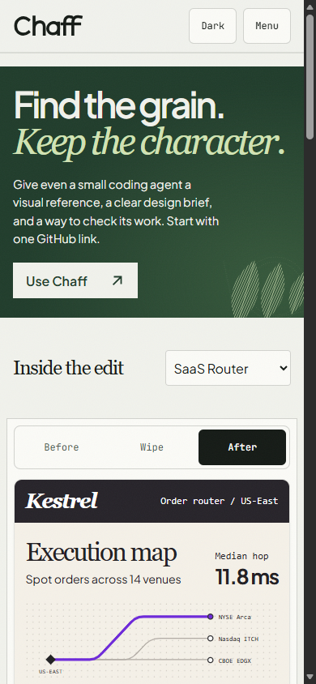

<p align="center"></p>

<h1 align="center">Frontend craft for small coding agents</h1>

Give your coding agent a visual target, a concrete design decision, and a way to inspect the result. Chaff uses your project's own content and brand. The showcase supplies a standard to aim for.

## Start with one link

Open your frontend workspace in an agent that can read GitHub and edit files. Paste:

```text
https://github.com/Ameya79/chaff
```

**Agent entry point:** Follow the [autonomous runbook](docs/link-run.md). With the URL alone, improve the primary public route. Add a route or brief if you want a different scope.

[Live showcase](https://chaff-ai.vercel.app/) · [Contribute](CONTRIBUTING.md) · [MIT license](LICENSE)

## See the target

| Desktop composition | Phone composition |
| --- | --- |
| [](docs/reference/showcase-desktop.png) | [](docs/reference/showcase-phone.png) |

In the Kestrel example, selecting a venue traces the order path and shows its timing. On a phone, the complete specimen opens first. The project keeps its violet accent at every width. [Inspect the implementation](apps/web/src/components/KestrelRouteSheet.tsx)

## How a run works

1. **Read the product.** Identify its audience, primary action, real content, framework and locked visual choices.
2. **Build one complete screen.** Choose the object the user needs to see or manipulate. Give it visual priority and connect the real action.
3. **Render and repair.** Inspect the route at 320, 390 and 1440 pixels. Exercise its main action, run the [browser check](docs/browser-check.js), and compare screenshots with the visual target.

The link workflow needs no Chaff installation. Visual verification requires a preview and browser access. Model-specific quality claims need independent runs on comparable tasks.

## Pick the scope

| Scope | Use it for |
| --- | --- |
| [Clean](levels/level-1.md) | Repairs inside the existing layout |
| [Authored](levels/level-2.md) | A redesigned route with a product-specific composition |
| [Risk](levels/level-3.md) | Requested 3D work with a lightweight fallback |

## Inside the repository

| Resource | What it contains |
| --- | --- |
| [Rule library](rules) | 72 rules covering layout, copy, code, performance, mobile, accessibility, motion and 3D |
| [Framework checks](packages/checks/src/tests/checks.test.ts) | Native-template cases for React, Next.js, SolidJS, Vite, Angular, AngularJS, SvelteKit, Vue, Nuxt and Astro |
| [CLI](packages/cli), [MCP server](packages/mcp), [GitHub Action](action) | Optional integrations for local projects and CI |
| [Reference fixtures](fixtures) | Small projects with known audit findings |
| [Model evaluation](bench/model-trial.md) | A repeatable comparison of the same model with and without Chaff |

Maintained by **Ameya Kulkarni**. [GitHub](https://github.com/Ameya79) · [LinkedIn](https://www.linkedin.com/in/ameya-kulkarni-a31b74246)
