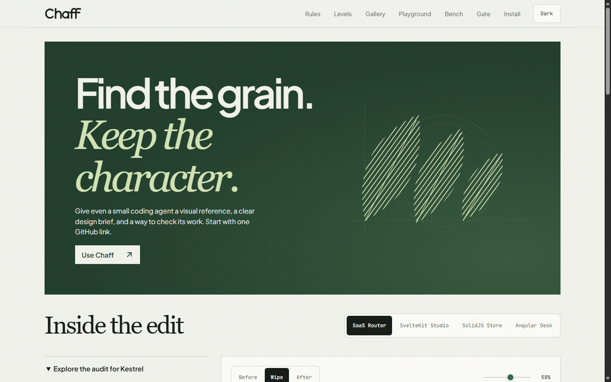

# Chaff

**Give a small coding agent a design brief it can actually execute.** Chaff turns a GitHub link into a frontend workflow: inspect the real product, compose one strong screen, build it, then render and revise it against the Chaff showcase.

## Start with one link

Open your frontend project in a coding agent that can read GitHub and edit the workspace. Paste this URL in chat:

`https://github.com/Ameya79/chaff`

A route or brief is optional. With the URL alone, use the project's primary public route. **Agents: open the [autonomous runbook](docs/link-run.md) now.** It contains the design decisions, visual references and browser check. No Chaff installation, MCP server, account, or second prompt is required. The agent needs a running preview and browser access to verify visual results.



### Supported Frontend Frameworks

Chaff's Identity Lock (`.chaff/identity.json`), rule checks, and build gates work natively across all major web stacks:
- **React & Meta-Frameworks**: Next.js (App Router / Pages), React, Vite, Remix
- **Signals & Compiled Frameworks**: SolidJS / SolidStart, Svelte / SvelteKit, Qwik
- **Enterprise & Ecosystem**: Angular (`(click)`, `ngSrc`, `@defer`, `dist/*/browser`), Vue 3 & Nuxt (`@click`, `defineAsyncComponent`, `<NuxtImg>`)
- **Islands & Static-First**: Astro (`client:visible`, `astro:assets`), Preact, Vanilla HTML/CSS/SCSS

---

## Three Creative Levels (Tailored Per Project)

| Level | Intent | What Changes | Guardrail |
| :--- | :--- | :--- | :--- |
| **Level 1 · Clean** | Safe tell removal | Contrast, type hygiene, copy polish, states, mobile overflow & tap targets (`<= 10` files) | Zero layout rewrites, zero new motion dependencies |
| **Level 2 · Authored** | Confident point of view | Project-specific direction (three pitches in guided mode), editorial/modular structure, 1 signature interaction | Max 1 lightweight motion dependency, `<= 170 KB` gzip JS |
| **Level 3 · Risk** | Interactive 3D & shaders | Custom WebGL/GLSL/Three.js showcase alongside clean minimal UI | **Mandatory 5-Part Fallback Contract** (`<= 250 KB` lazy chunk, `@chaff/tier`, DPR `<= 1.5`) |

See [`levels/level-1.md`](levels/level-1.md), [`levels/level-2.md`](levels/level-2.md), and [`levels/level-3.md`](levels/level-3.md) for the exact contracts.

---

## Optional CLI, MCP Server & GitHub Action

Want automated local gates or CI pull-request enforcement alongside the chat workflow? Every rule and budget engine ships cleanly in `@chaff/cli` and `@chaff/mcp`:

```bash
# Audit current workspace & generate scorecard
npx @chaff/cli audit --level 2

# Enforce First-Load JS, 320px overflow, 44px touch targets & L3 fallback contract
npx @chaff/cli gate --level 3

# Configure .chaff/identity.json and IDE pointer files
npx @chaff/cli init
```

### MCP Server Configuration
```json
{
  "mcpServers": {
    "chaff": {
      "command": "npx",
      "args": ["-y", "@chaff/cli", "mcp"]
    }
  }
}
```
Exposes 7 tools: `audit`, `plan`, `gate`, `get_rule`, `explain_finding`, `waive`, and `revert`.

### GitHub Actions CI Integration
```yaml
name: Chaff Gate

on:
  pull_request:
    branches: [main]

jobs:
  chaff:
    runs-on: ubuntu-latest
    permissions:
      contents: read
      pull-requests: write
    steps:
      - uses: actions/checkout@v4
      - uses: actions/setup-node@v4
        with:
          node-version: 20
      - run: npm ci
      - uses: chaff-dev/action@v1
        with:
          level: '2'
          fail-on-regressions: true
          comment-pr: true
        env:
          GITHUB_TOKEN: ${{ secrets.GITHUB_TOKEN }}
```

---

## The 8 Rule Categories (72 Rules)

- **UI (`rules/ui/`)**: `UI-001`..`009` — Layout rhythm, hierarchy, card sprawl, gradient glow tells.
- **Copy (`rules/copy/`)**: `COPY-001`..`009` — Domain-specific voice, zero buzzwords, no fabricated stats.
- **Code (`rules/code/`)**: `CODE-001`..`009` — Semantic HTML landmarks, framework idioms across React/Next/Solid/Angular/SvelteKit/Vue/Astro, TypeScript strictness.
- **Perf (`rules/perf/`)**: `PERF-001`..`009` — LCP/CLS hygiene, font loading, image `sizes`, slim initial JS.
- **Mobile (`rules/mobile/`)**: `MOBILE-001`..`009` — `dvh` sizing, `>= 44px` tap targets, zero horizontal overflow at `320px`.
- **A11y (`rules/a11y/`)**: `A11Y-001`..`009` — WCAG AA contrast, visible focus rings, form labels & ARIA semantics.
- **Motion (`rules/motion/`)**: `MOTION-001`..`009` — `prefers-reduced-motion`, compositor-only (`transform`, `opacity`) choreography.
- **Three / 3D (`rules/three/`)**: `THREE-001`..`009` — Dynamic chunk loading, static poster fallback, DPR `<= 1.5`, WebGL disposal, `< 250 KB` budget.

---

## Chaff Bench v0 Leaderboard

Evaluation across 10 diverse reference fixtures (see [`bench/METHODOLOGY.md`](bench/METHODOLOGY.md)):

| Rank | Agent | Model | Integration | Score | Slop Cut | Gate Pass | Net Diff |
| :---: | :--- | :--- | :--- | :---: | :---: | :---: | :---: |
| **#1** | **Google Antigravity** | Gemini 2.5 Pro | `AGENTS.md` / Universal Protocol | **97.4 / 100** | **98.2%** | **100%** | 142 lines |
| **#2** | **Claude Code** | Claude 3.5 Sonnet | `CLAUDE.md` / Native MCP | **96.2 / 100** | **96.5%** | **90%** | 168 lines |
| **#3** | **Cursor** | Claude 3.5 Sonnet | `.cursorrules` / MCP stdio | **93.8 / 100** | **92.4%** | **90%** | 194 lines |
| **#4** | **Windsurf** | Cascade (Sonnet) | `.windsurfrules` / MCP stdio | **91.5 / 100** | **89.8%** | **80%** | 210 lines |

---

## Repository Structure

```
chaff/
├── CHAFF.md                   # Single-file master autonomous agent protocol
├── AGENTS.md                  # Concise universal pointer for AI chat agents
├── CLAUDE.md                  # Claude Code workflow pointer & verification guide
├── rules/                     # 72 detection rules across 8 categories
├── levels/                    # Level 1 (Clean), Level 2 (Authored), Level 3 (Risk) contracts
├── packages/
│   ├── core/                  # Rules loader, Identity Lock, adapters, scoring
│   ├── checks/                # Source analyzers and rendered performance gate
│   ├── tier/                  # Device classification & frame governor runtime (~2 KB)
│   ├── mcp/                   # JSON-RPC 2.0 stdio Model Context Protocol server
│   └── cli/                   # chaff CLI (init, doctor, audit, level, gate, mcp)
├── action/                    # GitHub Action with sticky PR comment generator
├── apps/
│   └── web/                   # Next.js showcase site & interactive workflow demo
├── fixtures/                  # 10 reference web fixtures
├── bench/                     # Chaff Bench v0 evaluation runner and methodology
└── tests/                     # 61-test Python specification validation suite
```

## License

MIT © [Chaff Contributors](https://github.com/Ameya79/chaff). Keep the craft.
