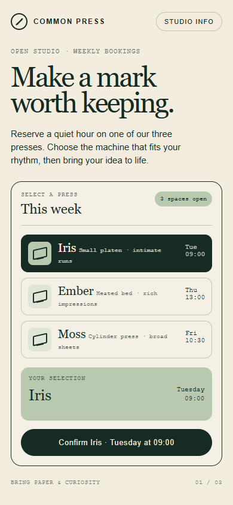
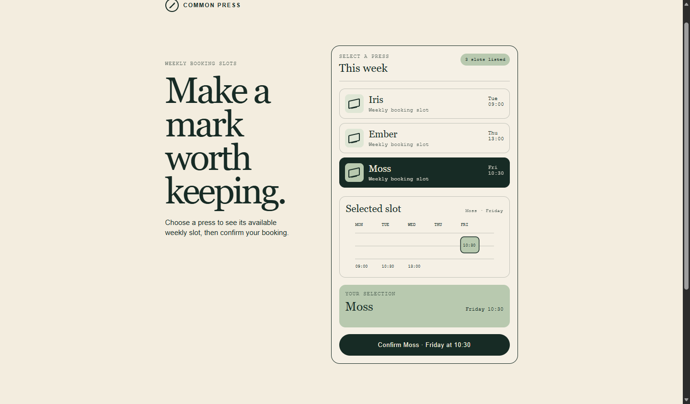

# Print studio booking trial

GPT-5.6 Luna received the Chaff runbook as text and a fresh brief in a read-only Codex session. The brief supplied three press names and booking times, an ink color and a paper color. The task was to produce standalone HTML with a meaningful selection visual and working confirmation. The model did not receive the showcase screenshots or an implementation from another model.

The first output could select Moss and confirm Friday at 10:30 at viewport widths of 320, 390 and 1440 pixels. The layout checker returned zero findings. A rendered review still found tiny secondary text, invented machine descriptions, and selection conveyed by class styling alone.

A separate session of the same model received its original HTML, the runbook and those observations. It added a schedule graphic and synchronized aria-pressed with selection. Browser checks at the same three widths verified the selected Moss button and confirmation text. The schedule annotations still read small on desktop.

This was a guided functional and visual smoke test with an external reviewer supplying repair feedback. There was one brief, no blind review and no unguided baseline. The trial does not measure autonomous GitHub-link discovery or performance of other models.
